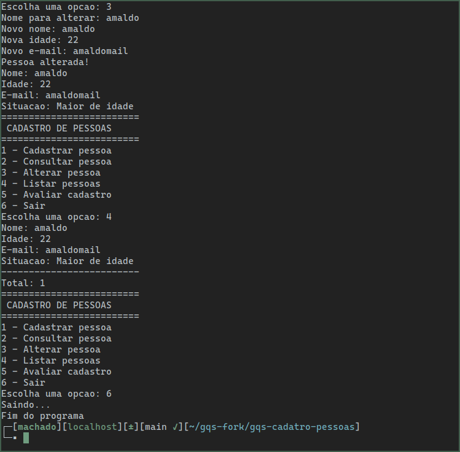
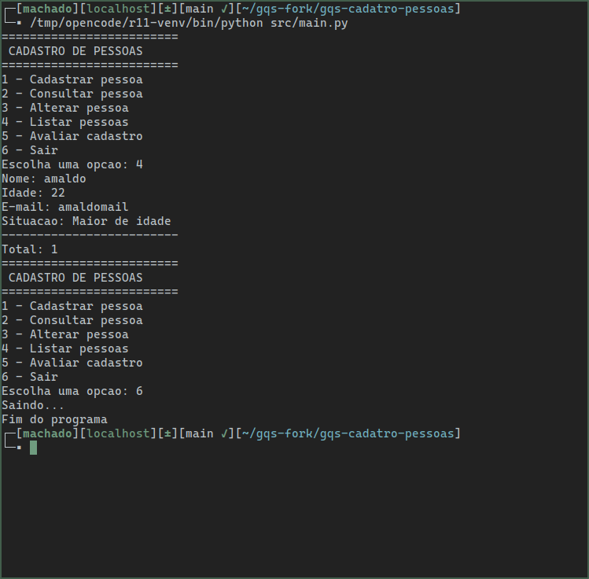
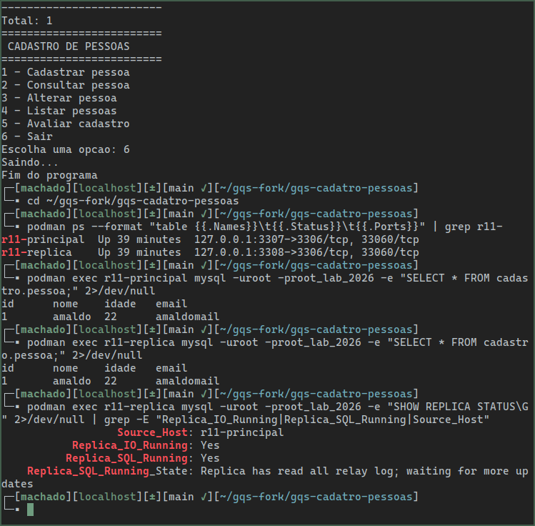
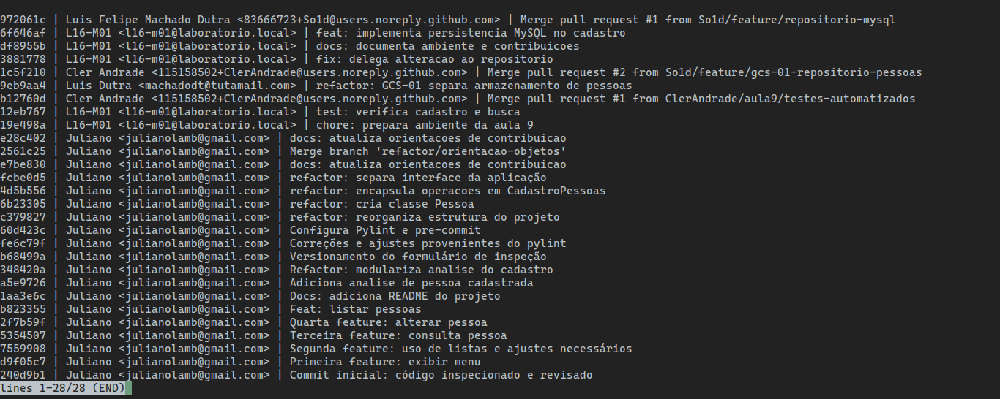

1 Repositório e participantes

O Projeto Integrador foi desenvolvido a partir do repositório disponibilizado pelo professor na Aula 1 e concentrado no repositório de Cler Andrade. O modelo de colaboração adotado foi o mesmo do Relatório 11: forks, branches locais e Pull Requests revisados por quem não escreveu o código. A Tabela 1 identifica os repositórios e os papéis de cada participante.

| Papel | Estudante | Repositório | Observação |
|---|---|---|---|
| Origem | Juliano Rodrigo Lamb | github.com/julianolamb/gqs-cadastro-pessoas | ponto de partida da disciplina |
| A | Luis Felipe Machado Dutra (So1d) | github.com/So1d/gqs-cadatro-pessoas | fork de B, recebeu a persistência em MySQL |
| B | Cler Andrade (ClerAndrade) | github.com/ClerAndrade/gqs-cadatro-pessoas | repositório principal deste relatório |

Tabela 1: Repositórios envolvidos no Projeto Integrador.

As contribuições entre A e B circularam nos dois sentidos, como no Relatório 11. A separação do armazenamento em memória, com a definição do contrato `RepositorioPessoas`, saiu de A para B pelo Pull Request #2. A persistência em MySQL saiu de B para A pelo Pull Request #1, cujo titulo foi:

`feat: implementa persistencia MySQL no cadastro`

O fechamento foi o Pull Request #3, `Contribute Final`, integrado por B em 19/11/2026. As quatro contribuições estão listadas na Seção 4.

2 Evolução do Cadastro de Pessoas

2.1 Organização do código

O código entregue na Aula 1 já continha `Pessoa`, `CadastroPessoas` e a interface de linha de comando em `src/main.py`. Nas aulas seguintes, o projeto foi reorganizado em funções, módulos e classes, sem alterar o contrato público usado pelo menu. A Tabela 2 descreve os arquivos que passaram a compor o sistema.

| Arquivo | Responsabilidade |
|---|---|
| `src/pessoa.py` | entidade com validação de nome e e-mail |
| `src/repositorio_pessoas.py` | contrato `RepositorioPessoas`, com `ABC` e `@abstractmethod` |
| `src/repositorio_pessoas_memoria.py` | implementação `RepositorioPessoasMemoria`, padrão do menu |
| `src/repositorio_pessoas_mysql.py` | implementação `RepositorioPessoasMySQL` com `mysql-connector-python` |
| `src/cadastro.py` | regras de negócio e delegação ao repositório |
| `src/main.py` | menu de comandos e leitura da variável `CADASTRO_REPOSITORIO` |
| `tests/` | verificações automatizadas com PyTest |
| `infra/compose.yaml` | principal e réplica MySQL 8.4.13 |
| `infra/README.md` | instruções de subida, criação da tabela e conexão |
| `documentos/` | checklists, métricas, rastreabilidade, evidências e relatórios |

Tabela 2: Arquivos do Projeto Integrador e suas responsabilidades.

A Figura 1 resume a dependência entre os módulos. O ponto central é que `CadastroPessoas` conversa apenas com o contrato; trocar `RepositorioPessoasMemoria` por `RepositorioPessoasMySQL` não exige mudança nas regras de negócio.


Figura 1. Relação entre `main`, regras de negócio, contrato e implementações de repositório.

2.2 Inspeção, métricas e refatoração

A Aula 6 registrou uma inspeção com checklist e a Aula 4 introduziu RADON. O maior bloco de complexidade estava em `executar()`, no menu, com índice B(8). A extração de `processar_opcao()` reduziu esse bloco para A(2). No Pylint, quatro regras estavam desligadas no `.pylintrc` (`invalid-name`, `missing-function-docstring`, `missing-class-docstring` e `trailing-whitespace`); com os nomes e as docstrings ajustados, a nota passou de 9,83 para 10,00. A Tabela 3 resume os resultados.

| Indicador | Antes | Depois | Evidência |
|---|---|---|---|
| Pylint | 9,83/10 | 10,00/10 | `documentos/checklist-pylint.md` |
| RADON — maior bloco | B(8) em `executar()` | A(2) em `processar_opcao()` | `documentos/metricas-radon.md` |
| RADON — média em `src/` | A (1,85) | A (1,80) | `documentos/metricas-radon.md` |
| Blocos B/C em `src/` | presentes | nenhum | saída de `radon cc src -a -s` |
| Testes | 23 | 27 | saída de `pytest -q` |

Tabela 3: Comparação das métricas antes e depois das correções.

A folha original de inspeção da Aula 2, com os nomes CLER, GUILHERME D., GABRIELA e LUIS, foi preservada em `documentos/evidencias/inspeção-aula2.pdf`. Os resultados do checklist preenchido estão em `documentos/checklist-inspecao-preenchido-aula6.md`.

2.3 Padronização e prevenção de defeitos

O `.pylintrc` passou a declarar `py-version=3.15`, que é a versão instalada no ambiente de execução. O `CONTRIBUTING.md` deixou de apontar o repositório do professor como origem do clone e passou a descrever o fluxo de branch, commit, push e Pull Request usado de fato. O `README.md` foi corrigido porque mandava executar `python cadastro.py`, enquanto o ponto de entrada sempre foi `src/main.py`.

O pre-commit foi ampliado para três verificações. Antes havia apenas Pylint, executado com o Python do sistema; agora os três hooks apontam para `.venv/Scripts/python.exe`. As verificações são Pylint no pacote `src`, PyTest completo e RADON em modo somente leitura. O Quadro 1 mostra a saída das ferramentas na última rodada.

```
python -m pytest -q
...........................                                              [100%]
27 passed in 0.15s

python -m pylint src
Your code has been rated at 10.00/10 (previous run: 10.00/10, +0.00)

python -m radon cc src -a
49 blocks (classes, functions, methods) analyzed.
Average complexity: A (1.7959183673469388)

pre-commit run --all-files
pylint (src).........................................(no files to check)Skipped
pytest...................................................................Passed
radon cc (somente leitura)...............................................Passed
```

Quadro 1. Saída das verificações automatizadas na revisão final.

3 Persistência e infraestrutura

3.1 Contrato e implementação MySQL

A Aula 11 introduziu a separação entre regras de negócio e armazenamento. O contrato `RepositorioPessoas` define `cadastrar()`, `buscar()`, `listar()` e `alterar()`. A implementação em memória continua sendo o padrão do menu; a implementação MySQL é ativada por `CADASTRO_REPOSITORIO=mysql`. A Tabela 4 lista as variáveis lidas por `repositorio_pessoas_mysql.py`.

| Variável | Uso | Valor |
|---|---|---|
| `DB_HOST` | host do MySQL | `localhost` |
| `DB_PORT` | porta mapeada no compose | `3307` |
| `DB_USER` | usuário | `root` |
| `DB_PASSWORD` | senha lida do ambiente local | definida em `.env`, nunca versionada |
| `DB_NAME` | banco | `cadastro` |

Tabela 4: Configuração da conexão MySQL.

A paginação usa `LIMIT` e `OFFSET` com uma contagem separada por `COUNT(*)`, sem recurso de contagem embutido na consulta principal. As demais operações usam parâmetros (`%s`) em vez de concatenação de strings. A confirmação é feita com `conn.commit()` após cada escrita e `conn.rollback()` em caso de falha; `conn.close()` é chamado em `finally`. Esses pontos foram revisados no Pull Request #1, originado da contribuição de B para A.

3.2 Docker Compose

O arquivo `infra/compose.yaml` define um servidor principal e uma réplica MySQL 8.4.13. A Tabela 5 registra os parâmetros conferidos na revisão final.

| Item | Configuração verificada |
|---|---|
| Imagem | `mysql:8.4.13` |
| Serviço principal | porta `3307` no host, `3306` no contêiner |
| Serviço réplica | porta `3308` no host, `3306` no contêiner |
| Volumes | `principal-data` e `replica-data`, nomeados |
| Rede | rede bridge padrão do Compose |
| Variáveis de ambiente | `MYSQL_ROOT_PASSWORD` obrigatória via ambiente, `MYSQL_DATABASE` |
| Comando da réplica | `CHANGE REPLICATION SOURCE TO` com `SOURCE_AUTO_POSITION=1` e `GET_SOURCE_PUBLIC_KEY=1` |
| Parâmetros do principal | `--log-bin=mysql-bin`, `--server-id=1`, `--gtid-mode=ON` |
| Parâmetros da réplica | `--relay-log=relay-bin`, `--server-id=2`, `--log-replica-updates=ON` |

Tabela 5: Configuração dos contêineres MySQL.

A senha do banco não aparece mais no arquivo versionado: o compose exige `MYSQL_ROOT_PASSWORD` no ambiente e `infra/.env.example` serve apenas de modelo. A validação local foi feita com `docker compose config --quiet`, que encerrou com código 0. O daemon do Docker não estava disponível nesta máquina (`docker info` falhou ao conectar em `npipe:////./pipe/dockerDesktopLinuxEngine`), por isso a execução ponta a ponta não foi repetida aqui. A execução com MySQL real foi feita em ambiente Linux com Podman e está registrada no Relatório 11. Neste repositório, o DAO foi verificado com um conector falso em `tests/test_repositorio_mysql.py`, que cobre paginação, mapeamento de linhas e o uso de `commit()` e `rollback()`.

A conferência no canal de replicação foi feita com o comando `SHOW REPLICA STATUS\G`, que apresenta `Replica_IO_Running`, `Replica_SQL_Running` e a posição do relay log. A Figura 6 registra essa verificação. Os três experimentos complementares da Aula 12 — atraso de replicação, réplica fora do ar e principal fora do ar — têm registro previsto em `documentos/experimentos-confiabilidade.md`; nesta entrega eles são retomados apenas como ressalva na Seção 7.

3.3 Verificação da migração

A migração de memória para MySQL foi exercitada sem alterar `CadastroPessoas`. O teste `test_alterar_delega_ao_repositorio` verifica que `alterar()` monta um novo objeto `Pessoa` e chama `repositorio.alterar()`. Esse desenho evita que a regra de negócio conheça detalhes de SQL, conexão ou autoincremento. A suíte completa, incluindo o DAO com conector falso, está listada no Quadro 1.

4 Colaboração por fork e Pull Request

A colaboração foi registrada em quatro Pull Requests. A Tabela 6 apresenta a direção, a autoria e o resultado de cada contribuição.

| PR | Direção | Título | Autor | Resultado |
|---|---|---|---|---|
| #1 | B → A | `feat: implementa persistencia MySQL no cadastro` | Cler Andrade (B) | mesclado em `972061c` |
| #2 | A → B | `refactor: GCS-01 separa armazenamento de pessoas` | Luis Felipe Machado Dutra (A) | mesclado em `9eb9aa4` |
| #3 | A → B | `Contribute Final` | Luis Felipe Machado Dutra (A) | integrado em 19/11/2026 |
| #1 (B) | B → A | branches `feature/repositorio-mysql` e `main` de B | Cler Andrade (B) | revisado por A e incorporado |

Tabela 6: Pull Requests da atividade.

Os pontos revisados em #1 foram a ausência de delegação em `alterar()`, o uso direto de `mysql.connector` no programa principal e a falta de fechamento de cursor e conexão. A versão mesclada usa o contrato, a variável de ambiente e o fechamento em `finally`.

```
 Os commits de consolidação deste repositório estão na Tabela 7.
```

Os commits de consolidação deste repositório estão na Tabela 7.

| Commit | Data | Mensagem |
|---|---|---|
| `2441169` | 19/11 | refactor: reduz complexidade |
| `4629f9f` | 19/11 | chore: configura Docker Compose e dependências de qualidade |
| `73e525c` | 19/11 | test: amplia cobertura com pytest e dao mysql |
| `b50847c` | 19/11 | fix: alinha versao do python na configuracao do pylint |
| `ac055fd` | 19/11 | docs: atualiza documentacao, metricas e rastreabilidade |
| `2f152d9` | 19/11 | docs: corrige texto e regera relatorio em PDF |
| `ab1ce09` | 20/11 | test: adiciona testes da entidade Pessoa |
| `13011c5` | 20/11 | fix: preserva modelo de checklist e adiciona registro preenchido |
| `99d1cd5` | 20/11 | chore: mapeia identidade do laboratorio para Cler Andrade |
| `d9f037c` | 21/11 | docs: adiciona capa UTFPR e reescreve relatorio como diario |

Tabela 7: Commits de consolidação no repositório de B.

5 Autoria e rastreabilidade

Três commits da máquina do laboratório foram gravados com a identidade `L16-M01 <l16-m01@laboratorio.local>`. Para que a autoria apareça corretamente sem alterar objetos já publicados, foi adicionado o arquivo `.mailmap` e ativada a opção `log.mailmap`. A Tabela 8 mostra o mapeamento aplicado.

| Identidade gravada | Identidade exibida | Mecanismo |
|---|---|---|
| `L16-M01 <l16-m01@laboratorio.local>` | Cler Andrade `<115158502+ClerAndrade@users.noreply.github.com>` | `.mailmap` + `git config log.mailmap true` |
| Juliano Rodrigo Lamb | Juliano Rodrigo Lamb | commit original do professor, ponto de partida |
| Luis Felipe Machado Dutra | Luis Felipe Machado Dutra | commit original do colega, evidência da colaboração |

Tabela 8: Identidades consideradas na auditoria de autoria.

Não houve reescrita desses objetos porque eles sustentam os Pull Requests mesclados. A auditoria completa está em `documentos/auditoria-final.md`, os dados de cada prática em `documentos/rastreabilidade.md` e a tag `v1.0.0-entrega` marca a versão final. O Quadro 2 mostra a saída recente de `git log --use-mailmap`.

```
d9f037c docs: adiciona capa UTFPR e reescreve relatorio como diario
2e5e1bb docs: reescreve relatorio como diario de desenvolvimento
1eb67e0 docs: registra auditoria do enunciado final e dos slides
13011c5 fix: preserva modelo de checklist e adiciona registro preenchido
ab1ce09 test: adiciona testes da entidade Pessoa
3a39217 docs: incorpora checklist de inspecao da aula 6
99d1cd5 chore: mapeia identidade do laboratorio para Cler Andrade
```

Quadro 2: Trecho de `git log --use-mailmap --oneline`.

O enunciado final também pedia um commit próprio por semana letiva, com mínimo de 17 semanas. O histórico deste repositório começa em 14/10 e os commits anteriores pertencem ao professor. Não foi inventada data antiga nem criado commit vazio para completar o quadro; a limitação está registrada em `documentos/plano-semanal.md` e `documentos/rastreabilidade.md`. Fora esse ponto, a `main` está sincronizada com o GitHub e o último `git status --short --branch` retornou apenas `## main...origin/main`.

6 Evidências de execução

As capturas a seguir foram extraídas do Relatório 11 entregue na disciplina e copiadas sem alteração para `documentos/evidencias/`. Elas registram a execução com MySQL em ambiente Linux com Podman, conforme relatado pelo colega, e complementam os testes automatizados executados neste repositório.


Figura 2. Inclusão de pessoa pelo menu de comandos.


Figura 3. Alteração de uma pessoa já cadastrada.



Figura 4. Listagem após as operações de escrita.



Figura 5. Consulta das linhas gravadas no banco MySQL.



Figura 6. Conferência da replicação com `SHOW REPLICA STATUS\G`.



Figura 7. Histórico de commits e merges no repositório de A.


Figura 8. Recorte do histórico no repositório de B, com a integração da contribuição.

7 Considerações finais

A evolução do Cadastro de Pessoas deixou o projeto mais próximo do que foi pedido nas Aulas 1 a 12. O contrato de repositório permitiu trocar memória por MySQL sem mexer nas regras de negócio; as métricas e o Pylint identificaram pontos que passaram por refatoração; o pre-commit e o PyTest deram uma forma repetível de verificar o código antes do commit. A colaboração por fork e Pull Request ficou registrada nos quatro PRs, incluindo `Contribute Final`, e no merge de `972061c`.

Dois pontos ficaram como ressalva explícita: a execução do MySQL com Docker não foi repetida nesta máquina por indisponibilidade do daemon, e o requisito das 17 semanas não foi preenchido retroativamente. Os experimentos de confiabilidade da Aula 12 também não foram repetidos aqui; seu registro está previsto em `documentos/experimentos-confiabilidade.md`. Ambos estão documentados, sem tentativa de mascarar a ausência com histórico fabricado. O relatório do colega (Relatório 11) permanece como evidência da execução com banco real e da colaboração em sentido inverso.

