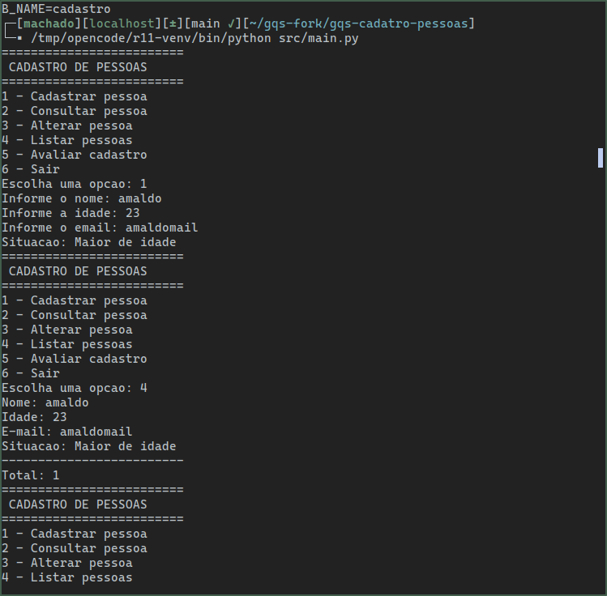
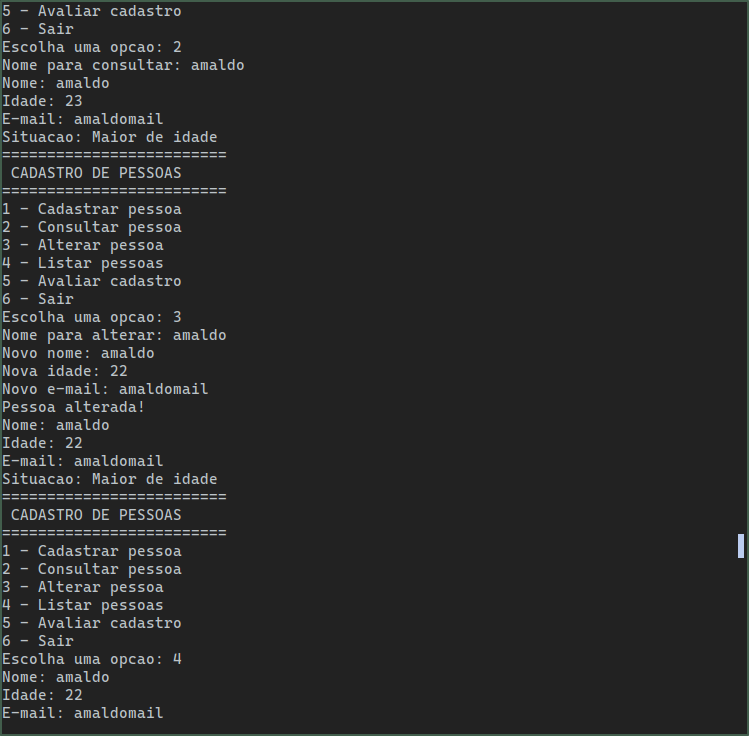
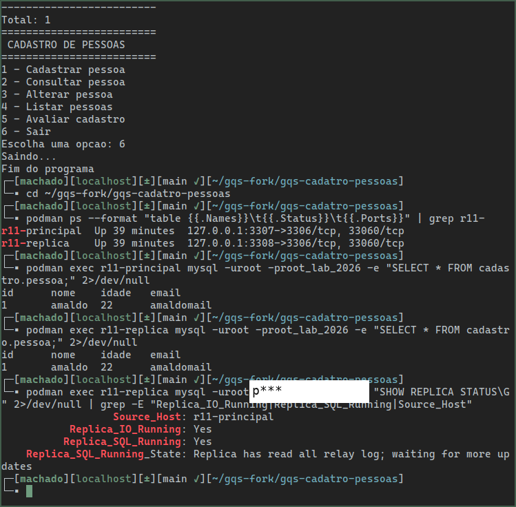
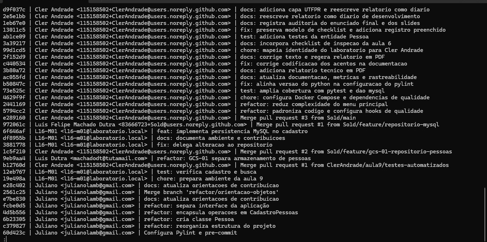

1 Repositório, participantes e papéis

O Projeto Integrador foi conduzido no repositório de Cler Andrade, a partir do projeto-base publicado pelo professor na Aula 1. A convenção de papéis adotada neste relatório segue o slide 57 e o título do Pull Request de persistência (`A -> B`): **A = Cler Andrade**, **B = Luis Felipe Machado Dutra**. As tabelas identificam sempre o login para evitar ambiguidade com a convenção invertida usada no Relatório 11. A Tabela 1 resume os repositórios.

| Papel | Estudante | Repositório | Observação |
|---|---|---|---|
| Origem | Juliano Rodrigo Lamb | `github.com/julianolamb/gqs-cadastro-pessoas` | ponto de partida da disciplina |
| A | Cler Andrade (`ClerAndrade`) | `github.com/ClerAndrade/gqs-cadatro-pessoas` | repositório principal deste relatório |
| B | Luis Felipe Machado Dutra (`So1d`) | `github.com/So1d/gqs-cadatro-pessoas` | fork do repositório de A |

Tabela 1: Repositórios envolvidos no Projeto Integrador.

O endereço com `cadatro` não é erro de digitação deste relatório: é a grafia real dos repositórios no GitHub, conferida em 25/11/2026. Renomeá-los quebraria os links dos quatro Pull Requests citados na Seção 6.

Este documento está organizado para responder três perguntas. O que foi feito aparece na Seção 3 e no diário da Seção 7. Como foi feito está nas Seções 2, 4 e 6, com comandos, configurações e referências a commits e Pull Requests. Como outra pessoa pode reproduzir está na Seção 2 e nos arquivos citados ao longo do texto.

As contribuições circularam nos dois sentidos. A separação do armazenamento saiu de B para A pelo Pull Request #2; a persistência em MySQL saiu de A para B pelo Pull Request #1 do repositório de B e voltou a A pelo Pull Request #3, `Contribute Final`. O Pull Request #1 de A reuniu os testes automatizados da Aula 9. A Seção 6 detalha cada integração.

2 Como preparar e verificar o projeto

Esta seção funciona como guia prático. Os comandos abaixo foram executados no ambiente Windows do laboratório, com PowerShell na raiz do repositório. Em outro clone, troque apenas o `Set-Location` pelo caminho local.

```powershell
Set-Location C:\Users\Usuario\Desktop\GQS\Aula1410\gqs-cadastro-pessoas
python -m venv .venv
.\.venv\Scripts\Activate.ps1
python -m pip install -r requirements.txt
python -m pre_commit install

python src\main.py
python -m pytest -q
python -m pylint src
python -m radon cc src -a -s
python -m pre_commit run --all-files
```

O `pre-commit install` precisa ser repetido em cada clone, porque o hook instalado fica em `.git/hooks` e não é versionado. O arquivo `.pre-commit-config.yaml`, sim, está versionado. `pytest.ini` define `pythonpath = src` e `testpaths = tests`; `requirements.txt` fixa as versões usadas nas verificações; `.pylintrc` registra as regras e o `py-version`.

### 2.1 Como reproduzir a colaboração por fork e Pull Request

O fluxo das aulas pode ser repetido com GitHub CLI. O fork cria o repositório de B e o `upstream` mantém o vínculo com A.

```powershell
gh repo fork ClerAndrade/gqs-cadatro-pessoas --clone
Set-Location gqs-cadatro-pessoas
git remote add upstream https://github.com/ClerAndrade/gqs-cadatro-pessoas.git

git switch -c feat/minha-alteracao
# editar os arquivos, depois verificar e publicar
python -m pytest -q
git add .
git commit -m "feat: descreva a alteracao realizada"
git push -u origin feat/minha-alteracao
gh pr create --base main --head feat/minha-alteracao --title "feat: descreva a alteracao" --body "Explique o que mudou e como foi verificado"
```

No repositório de A, a contribuição vinda do fork é conferida com `gh pr checkout <numero>` e integrada com `gh pr merge <numero>` após as verificações. Os PRs reais estão na Tabela 6; já estão integrados, logo os comandos acima descrevem o procedimento, não uma reexecução dos mesmos PRs.

### 2.2 Como subir o MySQL e criar a tabela

Os comandos abaixo documentam o procedimento de `infra/README.md`. Eles **não** foram executados na máquina deste relatório: o daemon do Docker não estava disponível; a validação local foi apenas `docker compose config --quiet`, com código 0.

```powershell
Set-Location infra
Copy-Item .env.example .env
# edite .env e defina MYSQL_ROOT_PASSWORD com valor local
$env:MYSQL_ROOT_PASSWORD = (Get-Content .env | Where-Object { $_ -like 'MYSQL_ROOT_PASSWORD=*' }).Split('=', 2)[1]
docker compose config --quiet
docker compose pull
docker compose up -d
docker compose ps

docker compose exec principal mysql -uroot -p$env:MYSQL_ROOT_PASSWORD -e "CREATE DATABASE IF NOT EXISTS cadastro CHARACTER SET utf8mb4; CREATE TABLE IF NOT EXISTS cadastro.pessoa (id INT AUTO_INCREMENT PRIMARY KEY, nome VARCHAR(100) NOT NULL, idade INT NOT NULL, email VARCHAR(200) NOT NULL UNIQUE);"
docker compose exec replica mysql -uroot -p$env:MYSQL_ROOT_PASSWORD -e "SHOW REPLICA STATUS\G"
Set-Location ..
$env:CADASTRO_REPOSITORIO = "mysql"
$env:DB_HOST = "localhost"; $env:DB_PORT = "3307"; $env:DB_USER = "root"
$env:DB_PASSWORD = $env:MYSQL_ROOT_PASSWORD; $env:DB_NAME = "cadastro"
python src\main.py
```

O vínculo de replicação (`CHANGE REPLICATION SOURCE TO`) é feito apenas na primeira subida, também conforme `infra/README.md`. Nenhuma senha real aparece neste relatório, no código Python ou no Compose; o valor fica somente em `.env`, que está no `.gitignore`.

A Tabela 2 apresenta a organização entregue.

| Arquivo ou diretório | Responsabilidade |
|---|---|
| `.gitignore` | exclui `.venv/`, `__pycache__/`, `.env` e cache do PyTest |
| `requirements.txt` | dependências fixadas para execução e verificações |
| `pytest.ini` | configuração da suíte (`pythonpath = src`, `testpaths = tests`) |
| `.pre-commit-config.yaml` | ganchos locais de Pylint, PyTest e RADON |
| `.pylintrc` | regras do Pylint e `py-version` |
| `.mailmap` | mapeia a identidade `L16-M01` para Cler Andrade |
| `src/pessoa.py` | entidade `Pessoa` com validação de nome e e-mail |
| `src/cadastro.py` | regras de negócio e delegação ao repositório |
| `src/repositorio_pessoas.py` | contrato abstrato `RepositorioPessoas` |
| `src/repositorio_pessoas_memoria.py` | implementação em lista, usada por padrão |
| `src/repositorio_pessoas_mysql.py` | DAO MySQL com `mysql-connector-python` |
| `src/main.py` | menu e leitura de `CADASTRO_REPOSITORIO` |
| `tests/` | verificações com PyTest, inclusive DAO com conector falso |
| `infra/compose.yaml` | principal e réplica MySQL 8.4.13 |
| `infra/README.md` | subida, criação da tabela e vínculo de replicação |
| `infra/.env.example` | modelo de variáveis de ambiente, sem senha real |
| `documentos/` | checklists, métricas, evidências, rastreabilidade e relatórios |

Tabela 2: Estrutura do repositório e função de cada parte.

3 Evolução do Cadastro de Pessoas

3.1 Das aulas iniciais à modularização

O código-base já trazia `Pessoa`, `CadastroPessoas` e o menu em `src/main.py`. A folha original de inspeção da Aula 2 foi preservada em `documentos/evidencias/inspeção-aula2.pdf`; os achados foram consolidados em `documentos/auditoria-aula2.md`. Nas aulas seguintes, o menu foi dividido em funções e o programa passou a registrar a pessoa cadastrada. A extração de `processar_opcao()` foi a mudança mais visível dessa etapa, registrada no commit `2441169`.

3.2 Métricas e refatoração

O RADON apontou `executar()` como o maior bloco do menu, com índice B(8). Depois da extração, o maior bloco passou para A(2). A média de complexidade em `src/` passou de A(1,85) para A(1,80), com 49 blocos analisados e nenhum acima de A. Os números anteriores e posteriores estão em `documentos/metricas-radon.md`.

3.3 Padrões, Pylint e prevenção de defeitos

O checklist da Aula 6 foi preenchido e mantido em `documentos/checklist-inspecao-preenchido-aula6.md`. O `.pylintrc` declara `py-version=3.15`, compatível com o ambiente de execução; a versão configurada inicialmente não batia com o interpretador usado nas aulas e foi alinhada no commit `b50847c`. Com nomes e docstrings ajustados, o Pylint saiu de 9,83/10 para 10,00/10.

Os dois arquivos de entrada foram revisados. O `README.md` descreve o programa, a estrutura principal, a preparação do ambiente, a execução nos modos memória e MySQL e as verificações; o ponto de entrada foi corrigido de `python cadastro.py` para `python src\main.py`. O `CONTRIBUTING.md` descreve o fluxo real de branch, mensagem de commit, push e abertura de Pull Request, incluindo as verificações locais que devem passar antes do envio.

O pre-commit reúne três verificações locais: Pylint em `src`, PyTest completo e RADON somente leitura. Todas usam o Python da `.venv`, para não depender da versão do sistema. O Quadro 1 mostra a saída da última rodada.

```
python -m pytest -q
...........................                                              [100%]
27 passed in 0.36s

python -m pylint src
Your code has been rated at 10.00/10 (previous run: 10.00/10, +0.00)

python -m radon cc src -a -s
49 blocks (classes, functions, methods) analyzed.
Average complexity: A (1.7959183673469388)

python -m pre_commit run --all-files
pylint (src).............................................................Passed
pytest...................................................................Passed
radon cc (somente leitura)...............................................Passed
```

Quadro 1: Resultado das verificações automatizadas na revisão final.

A Tabela 3 resume os indicadores acompanhados durante a evolução.

| Indicador | Antes | Depois | Evidência |
|---|---|---|---|
| Pylint | 9,83/10 | 10,00/10 | `documentos/checklist-pylint.md` |
| RADON — maior bloco | B(8) em `executar()` | A(2) em `processar_opcao()` | `documentos/metricas-radon.md` |
| RADON — média em `src/` | A(1,85) | A(1,80) | `documentos/metricas-radon.md` |
| Blocos B/C em `src/` | presentes | nenhum | `radon cc src -a -s` |
| Testes PyTest | 23 | 27 | `pytest -q` |

Tabela 3: Comparação das métricas antes e depois das correções.

3.4 Orientação a objetos e testes automatizados

A Aula 7 introduziu os cinco checkpoints de orientação a objetos, registrados em `documentos/checkpoints-aula7.md`. O contrato `RepositorioPessoas` usa `ABC` e `@abstractmethod` e define apenas `cadastrar()`, `buscar()`, `listar()` e `alterar()`. A implementação `RepositorioPessoasMemoria` é a padrão do menu; `RepositorioPessoasMySQL` pode substituí-la sem alterar as regras de negócio.

Os casos CT-01 e CT-02 estão em `documentos/casos-teste-ct01-ct02.md`. A suíte final reúne 27 testes, incluindo `tests/test_pessoa.py`, os testes do cadastro e um DAO falso para verificar `commit()`, `rollback()`, mapeamento de linhas e fechamento de cursor e conexão sem depender de um servidor MySQL.

4 Persistência e infraestrutura

4.1 Contrato e DAO MySQL

A implementação `RepositorioPessoasMySQL` é ativada por `CADASTRO_REPOSITORIO=mysql`. A Tabela 4 lista as variáveis lidas por `a_partir_do_ambiente()`. `DB_PASSWORD` é obrigatório: se não estiver definido, o método levanta `ValueError`. Não há senha padrão no código.

| Variável | Uso | Valor ou origem |
|---|---|---|
| `DB_HOST` | host do MySQL | padrão `localhost` |
| `DB_PORT` | porta mapeada no compose | padrão `3307` |
| `DB_USER` | usuário | padrão `root` |
| `DB_PASSWORD` | senha | obrigatória, lida do ambiente local |
| `DB_NAME` | banco | padrão `cadastro` |

Tabela 4: Configuração da conexão MySQL.

As consultas usam parâmetros `%s`, e a transação é confirmada com `commit()` e desfeita com `rollback()` em caso de erro. O sinalizador `ClientFlag.FOUND_ROWS` aparece em `__init__` para que `cursor.rowcount` reflita as linhas afetadas pelo `UPDATE`; ele não é recurso de paginação. O contrato atual não prevê paginação: `listar()` devolve todas as linhas em ordem de `id`.

4.2 Docker Compose

O arquivo `infra/compose.yaml` define um principal e uma réplica MySQL 8.4.13. A Tabela 5 registra os parâmetros conferidos na revisão final.

| Item | Configuração verificada |
|---|---|
| Imagem | `mysql:8.4.13` nos dois serviços |
| Principal | `127.0.0.1:3307:3306`, `server-id=1`, log binário e GTID |
| Réplica | `127.0.0.1:3308:3306`, `server-id=2`, relay log e GTID |
| Volumes | `principal-data` e `replica-data`, nomeados |
| Rede | bridge padrão do Compose |
| Senha | `MYSQL_ROOT_PASSWORD` obrigatória via ambiente, sem valor literal |
| Vínculo de replicação | manual, com `CHANGE REPLICATION SOURCE TO` em `infra/README.md` |
| Verificação | `SHOW REPLICA STATUS\G` |

Tabela 5: Configuração dos contêineres MySQL.

`docker compose config --quiet` terminou com código 0. O daemon do Docker não estava disponível nesta máquina, então a subida ponta a ponta não foi repetida aqui. A execução com banco real foi feita em ambiente Linux com Podman e está registrada no Relatório 11; suas capturas foram copiadas sem alteração para `documentos/evidencias/`, com atribuição explícita no `README.md` da pasta. A Figura 6 mostra as consultas SQL ao principal e à réplica e a conferência da replicação, com `Replica_IO_Running: Yes` e `Replica_SQL_Running: Yes`; a credencial visível na captura original foi mascarada na cópia usada no relatório.

Os três experimentos complementares da Aula 12 — atraso de replicação, réplica fora do ar e principal fora do ar — não foram executados nesta máquina. O registro está em `documentos/experimentos-confiabilidade.md` e a ausência é mantida como ressalva, sem resultado inventado.

5 Evidências de execução

As figuras a seguir registram a execução compartilhada do grupo e a integração no repositório. A Figura 1 foi elaborada para este relatório. As Figuras 2 a 6 são capturas do Relatório 11, produzidas na máquina do colega Luis Felipe Machado Dutra com Podman e MySQL real; as Figuras 7 e 8 reproduzem os históricos dos repositórios B e A. Nenhuma delas é prova de execução individual de A com MySQL: esta é a lacuna mais visível da entrega e permanece declarada. A autoria de A é comprovada pelos commits, branches e Pull Requests da Seção 6; a execução local neste repositório foi verificada com os testes automatizados do Quadro 1.


Figura 1. Relação entre menu, regras de negócio, contrato de repositório e implementações.



Figura 2. Inclusão de pessoa pelo menu de comandos (Relatório 11, máquina do colega).



Figura 3. Alteração de uma pessoa já cadastrada, de 23 para 22 anos (Relatório 11, máquina do colega).


Figura 4. Listagem pelo menu após as operações de escrita (Relatório 11, máquina do colega).


Figura 5. Execução do menu com persistência ativada: a captura mostra a listagem, não uma consulta SQL (Relatório 11, máquina do colega).



Figura 6. Consultas SQL ao principal e à réplica e conferência com `SHOW REPLICA STATUS\G` (Relatório 11, máquina do colega; credencial mascarada na cópia).


Figura 7. Histórico de commits e merges no repositório de B (`So1d`), com o merge `972061c` do PR #1 (Relatório 11).



Figura 8. Histórico no repositório de A (`ClerAndrade`), com o merge `e289160` do PR #3, `Contribute Final` (Relatório 11).

6 Colaboração, autoria e rastreabilidade

A Tabela 6 apresenta os quatro Pull Requests verificáveis. A direção A → B significa contribuição de `ClerAndrade` para o fork de `So1d`; B → A significa o caminho inverso.

| PR | Repositório | Direção | Título | Autor | Integração |
|---|---|---|---|---|---|
| #1 | `ClerAndrade` | branch local → `main` | `Aula9/testes automatizados` | `ClerAndrade` | `b12760d`, 21/10 |
| #2 | `ClerAndrade` | B → A | `refactor: GCS-01 separa armazenamento de pessoas` | `So1d` | `1c5f210`, 04/11 |
| #1 | `So1d` | A → B | `feat: implementa persistencia MySQL no cadastro (A -> B)` | `ClerAndrade` | `972061c`, 18/11 |
| #3 | `ClerAndrade` | B → A | `Contribute Final` | `So1d` | `e289160`, 19/11 |

Tabela 6: Pull Requests da atividade de colaboração.

A API do GitHub não registra submissões formais de review nem comentários de revisão nesses quatro PRs. A evidência disponível é o autor de cada PR, o branch de origem, o merge efetivo e o relato narrativo do Relatório 11. Por isso, este texto fala em integração e não afirma que houve aprovação formal registrada.

A Tabela 7 relaciona os principais commits de consolidação feitos por Cler Andrade a partir de 19/11, incluindo o merge do PR #3 que aparece na Figura 8. A lista completa pode ser obtida com `git log --use-mailmap --oneline`.

| Commit | Data | Mensagem |
|---|---|---|
| `e289160` | 19/11 | Merge pull request #3 from So1d/main (Contribute Final) |
| `5794cc2` | 19/11 | refactor: padroniza codigo e configura hooks de qualidade |
| `2441169` | 19/11 | refactor: reduz complexidade do menu principal |
| `4629f9f` | 19/11 | chore: configura Docker Compose e dependencias de qualidade |
| `73e525c` | 19/11 | test: amplia cobertura com pytest e dao mysql |
| `b50847c` | 19/11 | fix: alinha versao do python na configuracao do pylint |
| `ac055fd` | 19/11 | docs: atualiza documentacao, metricas e rastreabilidade |
| `ab1ce09` | 20/11 | test: adiciona testes da entidade Pessoa |
| `99d1cd5` | 20/11 | chore: mapeia identidade do laboratorio para Cler Andrade |
| `d9f037c` | 21/11 | docs: adiciona capa UTFPR e reescreve relatorio como diario |
| `7b56902` | 24/11 | docs: sincroniza markdown do relatorio com o pdf final |

Tabela 7: Commits de consolidação no repositório de A.

Cinco commits gravados na máquina do laboratório apareciam como `L16-M01 <l16-m01@laboratorio.local>`. O arquivo `.mailmap` e a opção `log.mailmap` os exibem como Cler Andrade sem reescrever objetos já publicados. O comando de verificação é:

```powershell
git --no-pager log --format='%h | %aN <%aE> | %s'
```

O histórico mapeado contém 72 commits: 51 de Cler Andrade, 19 do professor Juliano Rodrigo Lamb (exibido como `Juliano` no log), 1 de Luis Felipe Machado Dutra e 1 de Luis Dutra. Os commits do professor são o ponto de partida permitido; os do colega permanecem com a autoria original porque são evidência da colaboração. A auditoria detalhada está em `documentos/auditoria-final.md` e `documentos/rastreabilidade.md`. A tag `v1.0.0-entrega` marca a versão final.

```
d9f037c docs: adiciona capa UTFPR e reescreve relatorio como diario
2e5e1bb docs: reescreve relatorio como diario de desenvolvimento
1eb67e0 docs: registra auditoria do enunciado final e dos slides
13011c5 fix: preserva modelo de checklist e adiciona registro preenchido
ab1ce09 test: adiciona testes da entidade Pessoa
3a39217 docs: incorpora checklist de inspecao da aula 6
99d1cd5 chore: mapeia identidade do laboratorio para Cler Andrade
```

Quadro 2: Trecho de `git log --use-mailmap --oneline`.

7 Diário de desenvolvimento e índice de rastreabilidade

O enunciado final pede um commit próprio em cada uma das 17 semanas letivas. O histórico real não permite demonstrar essa distribuição: há vários commits de Cler Andrade concentrados em poucas datas e as semanas iniciais contêm apenas commits do professor. A lacuna é assumida: não existem 17 commits semanais e nenhum foi fabricado com data ou autoria retroativa. A dúvida sobre como tratar o requisito quantitativo deve ser encaminhada ao professor antes da entrega, conforme o item 19 do enunciado; até 25/11/2026 não havia resposta registrada.

O que se apresenta é somente o índice documental da Tabela 8. Em 25/11/2026, cada prática já evidenciada no repositório foi associada a um arquivo em `documentos/semanas/`. Os arquivos organizam evidências existentes — checklists, métricas, testes, infraestrutura e Pull Requests — para que a trajetória possa ser seguida sem depender da memória de quem executou. A coluna da direita aponta arquivos, não commits: nenhum deles é apresentado como registro feito na semana correspondente nem como cumprimento do item 10.

### 7.1 Dificuldades encontradas

- **Identidade da máquina do laboratório:** cinco commits apareciam como `L16-M01 <l16-m01@laboratorio.local>`. Como já estavam publicados e sustentavam PRs mesclados, a correção foi feita com `.mailmap`, sem reescrever os objetos.
- **Versão do Python no Pylint:** a configuração inicial não correspondia ao interpretador usado nas aulas; o ajuste de `py-version` ficou registrado no commit `b50847c`.
- **Docker indisponível:** `docker compose config --quiet` passou, mas o daemon não subiu nesta máquina. Por isso não há execução ponta a ponta própria, nem os três experimentos de confiabilidade da Aula 12.
- **Evidências de MySQL compartilhadas:** as capturas com banco real vieram do ambiente do colega; a autoria de A é demonstrada por commits e PRs, não por essas imagens.
- **Distribuição semanal ausente:** a criação de 17 commits em 25/11 foi descartada como substituto do requisito; o índice documental foi mantido com a ressalva acima.

| Semana | Prática registrada | Evidência original | Índice documental |
|---|---|---|---|
| 1 | Repositório-base e quality policy da Aula 1 | commits iniciais do professor e `README.md` | `semanas/semana-01.md` |
| 2 | Inspeção com checklist | `documentos/auditoria-aula2.md` e folha da Aula 2 | `semanas/semana-02.md` |
| 3 | Modularização e funções | commits `348420a`, `a5e9726`, `1aa3e6c` | `semanas/semana-03.md` |
| 4 | RADON e complexidade | `documentos/metricas-radon.md` | `semanas/semana-04.md` |
| 5 | Refatoração do menu | commit `2441169` | `semanas/semana-05.md` |
| 6 | Pylint e checklist preenchido | `documentos/checklist-pylint.md` | `semanas/semana-06.md` |
| 7 | Orientação a objetos | `documentos/checkpoints-aula7.md` | `semanas/semana-07.md` |
| 8 | Casos de teste e entidade | `documentos/casos-teste-ct01-ct02.md` e `tests/test_pessoa.py` | `semanas/semana-08.md` |
| 9 | PyTest e hooks | PR #1 de `ClerAndrade` e `.pre-commit-config.yaml` | `semanas/semana-09.md` |
| 10 | Baseline e itens de configuração | `documentos/baseline-indicadores.md` | `semanas/semana-10.md` |
| 11 | MySQL e Docker Compose | `infra/compose.yaml` e `infra/README.md` | `semanas/semana-11.md` |
| 12 | DAO e replicação | PR #1 de `So1d`; `src/repositorio_pessoas_mysql.py` | `semanas/semana-12.md` |
| 13 | Fork, branch e Pull Request | quatro PRs da Tabela 6 | `semanas/semana-13.md` |
| 14 | Auditoria e rastreabilidade | `auditoria-final.md` e `rastreabilidade.md` | `semanas/semana-14.md` |
| 15 | Checklist e testes da entidade | commits `13011c5` e `ab1ce09` | `semanas/semana-15.md` |
| 16 | Relatório e capa UTFPR | commits `d9f037c` a `7b56902` | `semanas/semana-16.md` |
| 17 | Consolidação da entrega | tag `v1.0.0-entrega` e este relatório | `semanas/semana-17.md` |

Tabela 8: Índice documental montado a partir de evidências existentes; a última coluna aponta arquivos, não commits.

Os arquivos foram criados em 25/11/2026 e não representam atividades feitas em cada semana letiva. Eles funcionam como um índice verificável das práticas já registradas no repositório; não substituem commits das semanas originais e não são apresentados como cumprimento do mínimo de um commit por semana. A decisão definitiva sobre o item 10 depende do retorno do professor, conforme o item 19.

8 Considerações finais

O projeto entregue mantém a evolução das Aulas 1 a 12, consolidada ao longo das 17 semanas letivas, em um único repositório: funções e classes, contrato de repositório, RADON, Pylint, pre-commit, PyTest, fork e Pull Request, DAO com MySQL, Compose com principal e réplica e documentação técnica. A verificação final registrada foi de 27 testes aprovados, Pylint 10,00/10, RADON com média A(1,7959) e `docker compose config --quiet` com código 0.

Cinco ressalvas permanecem explícitas: (1) a subida dos contêineres não foi repetida nesta máquina por falha do daemon Docker; (2) os experimentos de atraso e falha de réplica/principal da Aula 12 não foram executados; (3) as capturas com MySQL vieram da máquina do colega, não de execução própria de A; (4) a distribuição de um commit por semana letiva não existe no histórico real e foi substituída apenas por índice documental, com dúvida a encaminhar ao professor antes da entrega (item 19); (5) cinco commits da máquina do laboratório mantêm a autoria original corrigida por `.mailmap`, sem reescrita de objetos publicados. Nada disso foi mascarado com histórico, data ou autoria fabricados.
